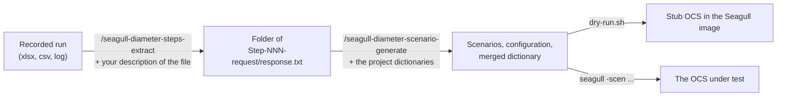

# seagull-diameter-scenarios

Skills that turn the Diameter requests and responses of a recorded test run into
[Seagull](https://gull.sourceforge.net/)
scenarios. The scenarios send the recorded requests again, check each answer, give up when an answer is late, and can be
tried first against a stub OCS, so no real charging system is needed to see that they work.

To install the package and run the skills, follow the [user guide](docs/user-guide.md).

## Skills

The first five skills are commands: the agent runs them only when you type their name, and takes their arguments
literally. A task can also have a skill that the agent picks from a plain request. That skill does the work, and the
command is a frontend for it with formal arguments. The plain skills so far:

| Plain-language skill                                                                                | The command it serves                  |
| --------------------------------------------------------------------------------------------------- | -------------------------------------- |
| [seagull-diameter-convert-dictionaries](.apm/skills/seagull-diameter-convert-dictionaries/SKILL.md) | `/seagull-diameter-dictionary-convert` |

When a plain request starts a task, the package instruction
[seagull-diameter-scenarios](.apm/instructions/seagull-diameter-scenarios.instructions.md) applies: the agent does not
start Docker, replace files, or choose dictionaries, placeholders, or flags on its own, and it says how it understood
your wording before it runs.

| Skill                                                                                                | Purpose                                                                                                            |
|------------------------------------------------------------------------------------------------------|--------------------------------------------------------------------------------------------------------------------|
| [/seagull-diameter-steps-extract](.apm/skills/seagull-diameter-steps-extract/SKILL.md)               | Turns a recorded run (an `xlsx` export, for example) into a folder of request and response files                   |
| [/seagull-diameter-scenario-generate](.apm/skills/seagull-diameter-scenario-generate/SKILL.md)       | Turns that folder into Seagull scenarios or templates, configuration, and a merged dictionary, then runs a dry run |
| [/seagull-diameter-scenario-templatize](.apm/skills/seagull-diameter-scenario-templatize/SKILL.md)   | Replaces the values of chosen AVPs in generated scenarios with `@@NAME@@` placeholders                             |
| [/seagull-diameter-scenario-externalize](.apm/skills/seagull-diameter-scenario-externalize/SKILL.md) | Makes chosen AVPs read their values from an external CSV data file, one row for each call                          |
| [/seagull-diameter-dictionary-convert](.apm/skills/seagull-diameter-dictionary-convert/SKILL.md)     | Converts the project's Diameter dictionaries into Seagull dictionaries, and can check them in the image            |
| [seagull-diameter-common](.apm/skills/seagull-diameter-common/SKILL.md)                              | Shared scripts and the format of the folder. Not a task; the agent never invokes it                                |



A folder of request and response files that you already have goes straight into the second skill.

## What the generated scenarios do

- One scenario for each Diameter session. Seagull refuses an answer whose Session-Id the call has not used, so steps
  with
  the same Session-Id are one scenario, and a new Session-Id starts another.
- Each request carries the recorded AVPs in the recorded order with fixed values. Only the Hop-by-Hop and End-to-End
  identifiers come from counters. Times and IP addresses are converted to the form Seagull sends.
- After each answer the scenario compares `Result-Code`, `Session-Id`, `Auth-Application-Id`, `CC-Request-Type`, and
  `CC-Request-Number` with the recorded answer, and fails the call on any difference.
- Seagull waits for each answer as long as `call-timeout-ms` in the configuration says (5000 ms by default).
- A `<default>` section answers a Device-Watchdog request from the OCS with a DWA.

## Options, tags, and templates

An options file, `scenario-options.ini`, next to the generated scenarios keeps what you decided: whether to write ready
scenarios or templates, which optional tags to add, and which AVP values become placeholders. You state each decision
once in a prompt; the file keeps it for the next run until you state another.

- **Ready scenario or template.** `mode=scenario` writes fixed values. `mode=template` writes `@@NAME@@` where you named
  an AVP, plus a values file with the recorded values. `apply_placeholders.py` fills a template in from `--set`
  arguments, the environment (`--env`), and the values file. `substitution=native` keeps the value inside the scenario
  as a Seagull variable instead.
- **Placeholders** are `AVP = NAME` pairs, with an optional path (`Subscription-Id/Subscription-Id-Data`) or index
  (`GGSN-Address[2]`).
- **Tags** that you can switch on: a Session-Id and Event-Timestamp made at runtime, a `<log>` line for each step,
  `<check-presence>`, and a `<wait-ms>` pause between steps. The `<default>` section for DWR is on by default.
- **Existing scenarios** become templates with `/seagull-diameter-scenario-templatize`.
- **Values from a data file.** `/seagull-diameter-scenario-externalize` makes chosen AVPs read their values from a CSV
  file while Seagull runs, one row for each call, in sequence or at random. It writes a new folder with the changed
  scenarios, the data file, and the configuration.

The format of the file is in [the common skill](.apm/skills/seagull-diameter-common/SKILL.md#the-options-file).

## Dictionaries

Seagull cannot read the project's dictionary format. The generate skill converts what it needs.
`/seagull-diameter-dictionary-convert` converts a whole folder of dictionaries into a new folder, merges the ones you
name into one file, reports what looks inconsistent, and can validate the sources and check each result in the Seagull
image. What the conversion does and drops is in [the dictionary conversion page](docs/dictionary-conversion.md).

## Requirements

- Python 3.9 or later, with no other package, to run the scripts.
- Docker and a Seagull 1.8.3 image tagged `seagull:local` for the dry run and for checking converted dictionaries. This
  repository does not build the image.
- Java 11 or later, only to validate dictionaries against their XSD files.
- The project's Diameter dictionaries in the project format, to find the vendor, the code, and the type of each AVP.

## Tests

```bash
python tests/selftest.py
```

The self-test generates scenarios from the invented dictionaries and steps in `tests/fixtures`. It also runs the dry run
in
the Seagull image when `SEAGULL_IMAGE` names the image (for example `SEAGULL_IMAGE=seagull:local`) and `sh` and `docker`
work.
