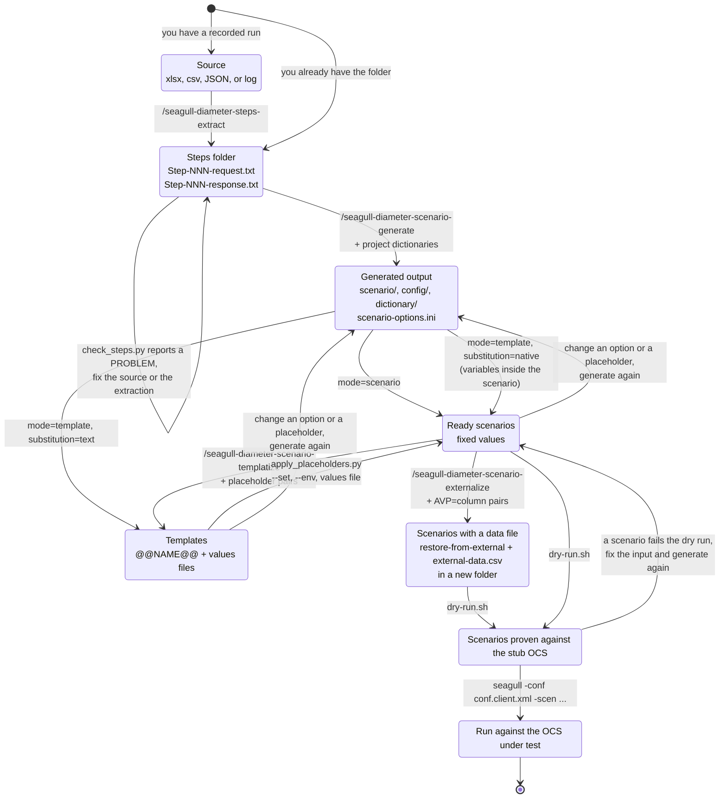
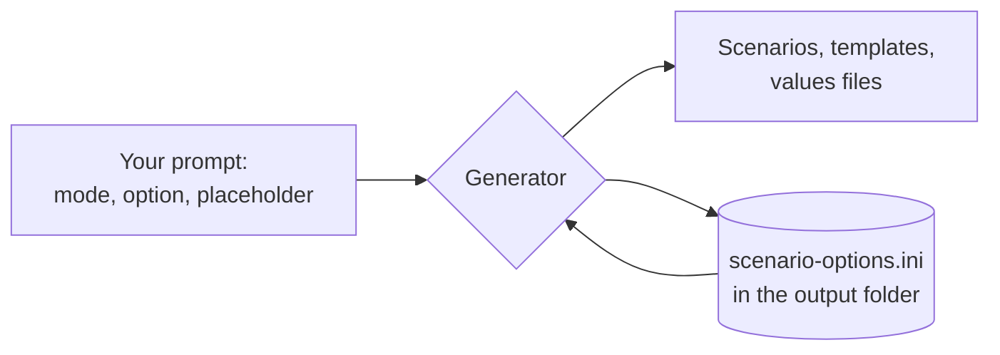

# How the skills work together

This page shows the states that your work passes through and the skill or script that moves it from one state to the
next. Use it to find where you are when something fails. The steps in detail, with prompts, are in the
[user guide](user-guide.md).

## States and transitions

A template is not run as it is. `apply_placeholders.py` fills it in first, and the generator does this itself for the
dry run, so the dry run always sees a filled-in scenario.

## What each transition needs and produces

| Transition                       | Moved by                                 | Needs                                                                  | Produces                                                                                                                        |
|----------------------------------|------------------------------------------|------------------------------------------------------------------------|---------------------------------------------------------------------------------------------------------------------------------|
| Source to Steps folder           | `/seagull-diameter-steps-extract`        | The source file and your description of its structure                  | `Step-NNN-request.txt`, `Step-NNN-response.txt`, `Steps-index.csv`                                                              |
| Steps folder to Generated output | `/seagull-diameter-scenario-generate`    | The folder, the project dictionaries, and the names to merge           | Client and stub scenarios, three configurations, the merged Seagull dictionary, `generation-report.txt`, `scenario-options.ini` |
| Ready scenarios to Templates     | `/seagull-diameter-scenario-templatize`  | Generated `*.client.xml`, and placeholder pairs                        | `*.client.xml.tpl`, `*.client.xml.values`                                                                                       |
| Ready scenarios to Data file     | `/seagull-diameter-scenario-externalize` | Generated `*.client.xml`, and `AVP=column` pairs                       | A new folder: changed scenarios, `scenario/external-data.csv`, configurations that name the file                                |
| Templates to Ready scenarios     | `apply_placeholders.py`                  | A template, and values from `--set`, the environment, or a values file | A filled-in `*.client.xml`                                                                                                      |
| Ready scenarios to Proven        | `dry-run.sh`                             | Docker and the image `seagull:local`                                   | One line for each scenario: `successful calls: 1, failed calls: 0`                                                              |
| Proven to Run                    | `seagull` command                        | The address of the OCS in `config/conf.client.xml`                     | Seagull logs and statistics CSV files                                                                                           |

## Dictionaries on their own

`/seagull-diameter-dictionary-convert` works apart from the scenarios. It takes the folder of the project's dictionaries
and writes a new folder of Seagull dictionaries. The generate skill does not need it, because it converts the
dictionaries it merges itself.

```mermaid
stateDiagram-v2
    direction LR

    state "Project dictionaries<br/>folder with DiameterBaseProtocol.xml" as Project
    state "Converted dictionaries<br/>new folder, conversion-report.txt" as Converted
    state "Dictionaries that Seagull loads" as Loaded

    [*] --> Project
    Project --> Project: validate=yes, validate.sh reports errors,<br/>tell the owners; the conversion goes on
    Project --> Converted: /seagull-diameter-dictionary-convert<br/>+ combine, rename
    Converted --> Loaded: check=yes, check-converted.sh
    Loaded --> [*]: seagull -dico ...
```

| Transition                        | Moved by                  | Needs                                        | Produces                                                             |
|-----------------------------------|---------------------------|----------------------------------------------|----------------------------------------------------------------------|
| Project to Converted dictionaries | `convert_dictionaries.py` | The folder, and a new or empty output folder | One Seagull file for each AVP dictionary, the combinations, a report |
| Converted to Loaded               | `check-converted.sh`      | Docker and the image `seagull:local`         | One line for each file: `successful calls: 1, failed calls: 0`       |

## Where the options file fits

`scenario-options.ini` is the memory of the generator. Each run reads it, applies the options and placeholder pairs that
you gave in the prompt, and writes it back. A decision therefore holds for every later run until you state another.

A prompt wins over the file for the keys it names. A key that the prompt does not name keeps the value from the file.

## Where a run stops

| State where it stops            | Signal                                              | What to do                                                                                             |
|---------------------------------|-----------------------------------------------------|--------------------------------------------------------------------------------------------------------|
| Steps folder, before generation | A `PROBLEM` line from `check_steps.py`              | Fix the extraction, or the source text, and extract again                                              |
| Generation, before any file     | `the output folder is not empty: ...`               | Use another folder, or `replace=yes` to move the old contents to a `.previous-<time>` folder           |
| Generation                      | `AVP <name> is in none of the project dictionaries` | Add the dictionary that defines the AVP to `merge=`                                                    |
| Generation                      | `the command <X> is not in ...`                     | Add the dictionary of the application that defines the command                                         |
| Generation                      | `generated-timestamp needs time-method`             | Name a time method, or leave the option off                                                            |
| Generation, template            | `no value for placeholder(s) NAME`                  | Give the value in the values file, with `--set`, or with `--env`                                       |
| Conversion                      | `DiameterBaseProtocol.xml is required`              | Add the base protocol dictionary to the input folder                                                   |
| Conversion, before any file     | `the output folder is not empty: ...`               | Use another folder; the skill never empties one                                                        |
| Dictionary check                | `successful calls: 0, failed calls: 1`              | Read the `E` lines: Seagull could not load the dictionary, or it lacks an AVP that the check sends     |
| Dry run                         | `no statistics file`                                | Seagull did not start: check the image and the line endings                                            |
| Dry run                         | `successful calls: 0, failed calls: 1`              | Read the `E` error line that the script prints next to it; the cause is in the input or the dictionary |
